<h1 align="center">
  <br>
  RepoNorm
</h1>

<p align="center"><strong>Acquiring and Verifying Repository Norms for Coding Agents</strong></p>

<p align="center">
  <a href="https://huggingface.co/datasets/SYSUSELab/RepoNormBench"></a>
  <a href="https://huggingface.co/spaces/SYSUSELab/RepoNormBench-Leaderboard"></a>
  <a href="https://arxiv.org/abs/2610.07757"></a>
</p>

<p align="center">
  <a href="docs/assets/paper-workflow.png"><picture>
    <source media="(max-width: 600px)" srcset="docs/assets/overview.svg#mobile">
    
  </picture></a><br>
  <sub><a href="docs/assets/paper-workflow.png">View the full workflow from the paper</a></sub>
</p>

A Jinja patch added case-sensitive grouping and passed all **171 functional checks**.
It still missed the changelog entry that Jinja requires for code changes. The
task never mentioned the changelog. [Read the Jinja task](benchmark/tasks/JIN-F01/feature.md).

RepoNorm discovers written rules and infers conventions from code before a coding
task begins. It checks each rule and its scope against a fixed repository snapshot,
consulting Git history when needed. The agent receives a static Markdown package
it can browse by file path, with conditions, exceptions, and source evidence for each rule.

## RepoNormBench

The benchmark covers **121 tasks** across 14 snapshots of six Python repositories.
It records which of 160 reference norms apply to each task, yielding 1,024
task–norm associations. [Browse the tasks and annotations](benchmark/README.md).

The paper reports **1,089 executions** across three coding models and three
conditions. With RepoNorm, the models' overall norm compliance rates improved
by **7.42–10.77%** relative to the Raw baseline, where the agent receives no
additional generated guidance.

New experiments and the leaderboard use the corrected default test for
`JIN1559-F07`, so leaderboard scores may differ from the paper results.
The archive retains the earlier `message-literal` test for historical reproduction.

## Reproduce the reported results

Use Python **3.12**, Git, and a virtual environment. Run the following from the
repository root.

```bash
python3.12 -m venv .venv
source .venv/bin/activate
python -m pip install -r requirements.txt
python tools/validate_release.py
python -m reproduction
```

The analysis runs offline on the included data, without API credentials, model
calls, or Docker. It recomputes the main results, paired
confidence intervals, significance tests, sensitivity analyses, quality
summaries, calibration counts, and recorded costs. Tables and figures are written
to `outputs/reproduction/`. For a quick check of point estimates, use
`python -m reproduction --skip-bootstrap`.

The guides describe the metrics, expected outputs, and provenance of the released
inputs. [Reproduction guide](docs/reproduction.md) · [Data guide](data/README.md)

## Run RepoNorm or new experiments

With the environment above active, open the bundled tiktoken package in the
[local knowledge explorer](docs/acquisition.md#explore-an-extracted-package).
Select a rule to see where it applies and which source lines support it.

```bash
repo-memory-v3 visualize data/knowledge/reponorm/tik-4560a8896f5f.zip
```

<details>
<summary>Inspect the tiktoken evidence and recorded patches</summary>

1. **Discover.** At snapshot `4560a8896f5f`, the configuration declares a Python floor of 3.9. In a separate discovery path, RepoNorm infers an encoding convention from `tiktoken/core.py`.
2. **Verify.** Lines 79–133 show where the convention applies. If the Rust encoder raises `UnicodeEncodeError`, `Encoding.encode` repairs the input with UTF-16 and retries. RepoNorm checks candidates against current evidence and consults Git history when needed.
3. **Package.** The Accepted-Only Markdown view indexes the observed rule under `tiktoken/core.py`. From `START.md`, the agent can reach its condition and source lines. An optional review can add individually approved candidates to a reviewed view. [Inspect the released package](data/knowledge/reponorm/tik-4560a8896f5f.zip).
4. **Apply.** Task TIK-F04 adds overlapping character windows. Both DeepSeek V4 Flash patches passed the functional tests. On the surrogate-recovery check for the new windows (`TIK-N02`), the Raw patch failed and the RepoNorm patch passed. [Task](benchmark/tasks/TIK-F04/feature.md) · [Raw patch](data/results/patches/deepseek/raw/TIK-F04.patch) · [RepoNorm patch](data/results/patches/deepseek/reponorm/TIK-F04.patch).

</details>

- Analyze a repository, validate its norm package, and export an agent-readable
  view. Start with the offline example in the [acquisition guide](docs/acquisition.md).
- Prepare frozen snapshots and Docker resources, use released knowledge, generate
  a CodeWiki baseline, and score new patches with the [experiment guide](docs/experiments.md).

The public conditions are `raw`, `codewiki`, and `reponorm`. The coding models are
DeepSeek V4 Flash, Qwen3.5 Flash, and Gemini 3.1 Flash Lite. Exact model aliases,
provider routes, budgets, and settings are retained with each selected execution.
New calls to a hosted model can produce different results.

## Repository layout

| Path | Contents |
| --- | --- |
| `repo_constraint_memory_v3/` | Acquisition, validation, export, and review implementation |
| `skills/norm4code/` | Static knowledge consumption instructions |
| `benchmark/` | Unified task index, task artifacts, norms, and runtime contracts |
| `data/` | Selected results, patches, knowledge packages, and assessment data |
| `reproduction/` | Analysis of the released data |
| `runner/` | Snapshot preparation and isolated coding execution |
| `evaluation/` | Norm checkers and patch scoring |
| `CooperBench/`, `CodeWiki/` | Adapted upstream components |
| `tests/` | Runner and integration tests |

## Release scope

The release includes 14 Accepted-Only knowledge views (1,990 entries), 14
Accepted-after-Review views (6,277 entries), and 14 CodeWiki views. It also
includes precision samples, coverage assessments, and 140 entries with judgments
from two human reviewers, together with sample selection and agreement analysis.

[Third-party provenance](docs/third-party.md) identifies the included components.

## Citation

```bibtex
@misc{he2026acquiringverifyingrepositorynorms,
  title         = {Acquiring and Verifying Repository Norms for Coding Agents},
  author        = {Kaifeng He and Xiaojun Zhang and Zhenxi Chen and Christoph Treude and Mingwei Liu},
  year          = {2026},
  eprint        = {2610.07757},
  archivePrefix = {arXiv},
  primaryClass  = {cs.SE},
  url           = {https://arxiv.org/abs/2610.07757}
}
```
